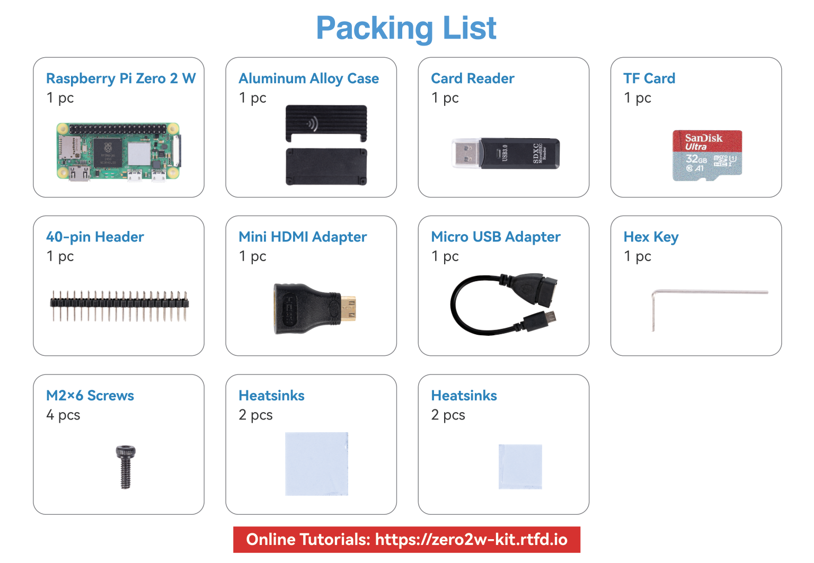
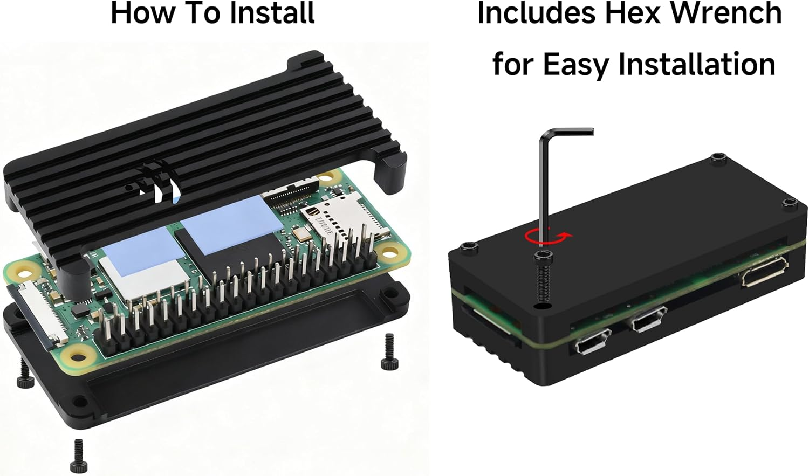
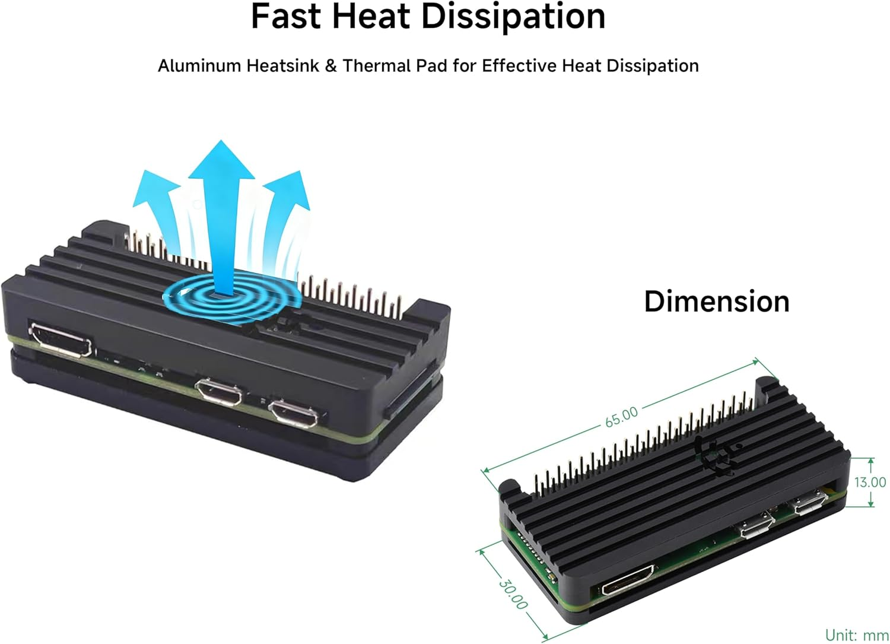

.. note::

    Hello, welcome to the SunFounder Raspberry Pi & Arduino & ESP32 Enthusiasts Community on Facebook! Dive deeper into Raspberry Pi, Arduino, and ESP32 with fellow enthusiasts.

    **Why Join?**

    - **Expert Support**: Solve post-sale issues and technical challenges with help from our community and team.
    - **Learn & Share**: Exchange tips and tutorials to enhance your skills.
    - **Exclusive Previews**: Get early access to new product announcements and sneak peeks.
    - **Special Discounts**: Enjoy exclusive discounts on our newest products.
    - **Festive Promotions and Giveaways**: Take part in giveaways and holiday promotions.

    👉 Ready to explore and create with us? Click [|link_sf_facebook|] and join today!

.. _components:

What's in the Box?
==================

|

Unpack the kit and lay everything out on the table. Check that each item below is present
before you start.

.. list-table::
    :header-rows: 1
    :widths: 8 32 44 16

    * - Qty
      - Item
      - Specification
      - Part No.

    * - 1
      - Raspberry Pi Zero 2 W
      - Quad-core 1 GHz 64-bit, 512 MB RAM, Wi-Fi and Bluetooth on board.
        **The 40-pin GPIO header is already soldered on.**
      - CN0456

    * - 1
      - TF card
      - SanDisk Ultra 32 GB, Class 10 / A1, with a full-size SD adapter.
      - ST0125

    * - 1
      - Card reader
      - USB 3.0 / 2.0, reads microSD and full-size SD cards.
      - A0001439

    * - 1
      - Aluminum alloy case set
      - Two-piece black anodised aluminium case, plus the adapters, heatsinks, screws
        and hex key listed below.
      - A0001440

    * - 1
      - Packing box and card
      - Retail packaging — keep it if you plan to store or resell the kit.
      - A0001441 / A0001442

Inside the Case Set
-------------------

The case set (A0001440) is the only item packed as loose parts. Empty the bag and separate
it into these groups:

.. list-table::
    :header-rows: 1
    :widths: 10 35 55

    * - Qty
      - Part
      - Notes

    * - 1
      - Case lid
      - The ribbed aluminium plate with the Wi-Fi antenna symbol on it. It is the heatsink.

    * - 1
      - Case base
      - The flat plate with four threaded posts in the corners.

    * - 2
      - Large heatsinks
      - Light blue, self-adhesive on both faces. Larger size; these go over the two main
        chips.

    * - 2
      - Small heatsinks
      - Light blue, self-adhesive on both faces. Smaller size; these go over the remaining
        hot components.

    * - 4
      - M2×6 screws
      - Black hex-head screws for the four corner posts.

    * - 1
      - Hex key
      - 1.5 mm. The only tool you need for the whole build.

    * - 1
      - Micro USB adapter
      - Short cable, Micro-B male to USB-A female. Lets you plug a keyboard or a USB hub
        into the Pi.

    * - 1
      - Mini HDMI adapter
      - Adapter from Mini HDMI (on the Pi) to standard HDMI (for a monitor).

    * - 1
      - 40-pin header
      - Already soldered to the board. It is listed here only so you know what the black
        block along the top edge of the Pi is.

.. note::
    The bag contains **four self-adhesive heatsinks in two sizes** — two large and two
    small. Peel the backing off and press them onto the chips, large ones on the two main
    square chips, small ones on the smaller components next to them. Fit all four; each
    one cools a different component. They stick to the **board**, not to the case.

Putting the Case On
-------------------

The case is a base plate, a ribbed lid, four screws and the hex key — no step needs more
than a screwdriver.

         four screws with the supplied hex wrench

#. Peel the backing off the **heatsinks** and press them onto the chips on the board.
#. Lower the board into the **base plate**, component side up, aligning the ports with the
   cut-outs.
#. Set the **lid** on top.
#. Drop the four screws in, start them by hand, then tighten them diagonally with the
   **hex key**. Stop as soon as each one feels snug — the screws thread into aluminium and
   the board underneath is thin.

         65 x 30 x 13 mm

The lid **is** the heatsink, so the case runs warm in use — that is heat leaving the
processor, not a fault. Assembled, the kit measures **65 × 30 × 13 mm**.

What Else Do You Need?
----------------------

Everything below is **not** included in this kit, and you need at least the first two
items before the Pi will boot.

Required
~~~~~~~~

* **Power adapter** — 5 V / 2 A (or higher) with a **Micro USB** plug. The official
  Raspberry Pi 12.5 W Micro USB supply is ideal. A phone charger rated below 2 A, or a
  USB-A port on a laptop, will cause undervoltage warnings and random reboots.

  .. warning::
      The Pi Zero 2 W uses **Micro USB** for power, not USB-C. Do not force a USB-C
      cable into the port.

* **A computer** — Windows, macOS or Linux, with an SD card slot or a USB port for the
  card reader that comes with the kit. You need it to write the operating system.

Strongly Recommended
~~~~~~~~~~~~~~~~~~~~

* **Keyboard and mouse** — the micro USB OTG adapter in the kit converts the Pi's Micro-B
  data port to a full-size USB-A socket, so a wired keyboard works directly. A USB hub is
  handy if you want a keyboard *and* a mouse at the same time, because the Zero 2 W only
  has one data port.

* **Monitor** — any HDMI screen. Use the Mini HDMI adapter from the kit. If your Pi is
  headless, skip this: :doc:`Setting Up Your Raspberry Pi </set_up_pi>`
  covers the no-screen route over SSH.

Optional
~~~~~~~~

* **Ethernet** — the Zero 2 W has no Ethernet port. If you prefer a cable over Wi-Fi you
  need a USB-to-Ethernet adapter, plugged into the OTG port.

* **USB hub with power** — useful when you are debugging and need several peripherals.

.. tip::
    If you do not own a monitor, keyboard or mouse, that is fine — this kit is designed
    to be set up **headless**. You will do everything over Wi-Fi from your own computer.
    See :doc:`Setting Up Your Raspberry Pi </set_up_pi>`.

Next Step
---------

Head to :doc:`Installing the Operating System </_shared/pi_start/install_os_trixie>` to put
Raspberry Pi OS on the card.
