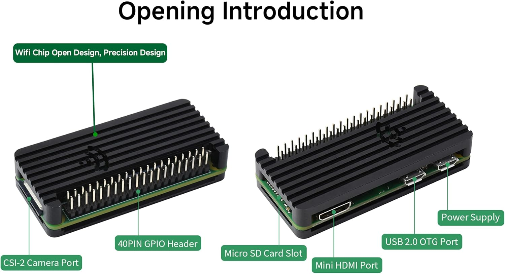

.. note::

    Hello, welcome to the SunFounder Raspberry Pi & Arduino & ESP32 Enthusiasts Community on Facebook! Dive deeper into Raspberry Pi, Arduino, and ESP32 with fellow enthusiasts.

    **Why Join?**

    - **Expert Support**: Solve post-sale issues and technical challenges with help from our community and team.
    - **Learn & Share**: Exchange tips and tutorials to enhance your skills.
    - **Exclusive Previews**: Get early access to new product announcements and sneak peeks.
    - **Special Discounts**: Enjoy exclusive discounts on our newest products.
    - **Festive Promotions and Giveaways**: Take part in giveaways and holiday promotions.

    👉 Ready to explore and create with us? Click [|link_sf_facebook|] and join today!

.. _faq:

FAQ
===

Hardware
--------

**What power supply does the Pi Zero 2 W need?**

5 V / 2 A (10 W) or better, with a **Micro USB** plug. Under 2 A the board will show the
undervoltage warning and may reboot under load. A USB port on a laptop is not enough.

**Which Micro USB port is which?**

They are labelled in tiny white text on the board:

* **USB** — data. This is the OTG port, for the keyboard/mouse adapter.
* **PWR IN** — power only. The power supply goes here.

They look identical and it is easy to swap them. Nothing is damaged if you do, but the
board will not work.

         supply, Micro SD card slot, 40-pin GPIO header, CSI-2 camera port

**Do I need to solder anything?**

No. The 40-pin GPIO header is already soldered to the board, and the case assembles with
the four supplied screws and the 1.5 mm hex key.

**Why does the case get warm?**

That is the design working. The aluminium case *is* the heatsink: the self-adhesive
heatsinks on the chips press against the metal lid, and heat spreads through the whole
case. A warm lid means heat is leaving the chip. It should never be too hot to touch for a
second or two.

**The lid did not sit flat after I closed the case.**

A heatsink is folded, doubled up, or off-centre. Open the case and check that each
heatsink lies flat on its chip. Do not stack two heatsinks on one component.

**My screw will not start.**

It is cross-threaded, not the wrong size. Back it out completely and start it again,
turning anticlockwise until you feel it drop into the existing thread, then tighten.

microSD and Boot
----------------

**Which card should I use?**

The 32 GB SanDisk card in the kit is exactly right. If you buy a replacement, use a
branded Class 10 / A1 or better card from 16 GB to 64 GB. Cheap unbranded cards are the
most common cause of mysterious boot failures.

**Which operating system should I install?**

**Raspberry Pi OS** — the desktop edition if you want a GUI, Lite if you only need SSH.
Either is fine on a Zero 2 W; there is nothing in this kit that depends on one or the other.

**The green LED blinks a few times and then nothing happens.**

The card was not written correctly, or it is faulty. Re-run Raspberry Pi Imager and let
the verification step finish. If it fails in the same place twice, try another card.

**The Pi boots but there is no video on my monitor.**

Check the Mini HDMI adapter is fully seated at both ends, that you selected the right HDMI
input on the monitor, and that you are using a **standard** HDMI cable — not a
Micro HDMI cable, which will not fit the adapter's output side.

**Can I use a 5 GHz Wi-Fi network?**

No. The Zero 2 W radio is 2.4 GHz only. Use the 2.4 GHz SSID, or the combined SSID if
your router publishes one.

Network and Remote Access
-------------------------

.. _hostname_and_local:

**``<hostname>.local`` does not resolve.**

The card ships blank, so the hostname, username and password are the ones **you** entered
in Raspberry Pi Imager before writing it — there is no default, and nothing on the card
tells you what they are. If you cannot remember the hostname, connect a screen and run
``hostname``, or look the Pi up by its MAC address in your router's client list.

``.local`` name resolution (mDNS) also needs both devices on the same subnet and a client
that speaks mDNS. Windows needs Bonjour or a recent build with mDNS enabled; some guest
and mesh networks block multicast entirely. Find the Pi's IP address in your router's DHCP
list and connect to the IP instead — that always works, whatever the hostname is.

**Can I connect a Pi Zero 2 W with an Ethernet cable?**

Not directly — there is no Ethernet port. Use a USB-to-Ethernet adapter in the OTG port,
or a USB Wi-Fi adapter. The built-in Wi-Fi is usually the simplest option.

**SSH says "Connection refused".**

SSH was not enabled when you wrote the card. Shut down the Pi, put the card back in your
computer, re-run Imager and enable SSH under the **SERVICES** tab, then write the card
again.

**I forgot my password.**

There is no recovery without a screen or SSH access. The quickest fix is to re-image the
card with Raspberry Pi Imager and set the credentials again. Any data on the card is lost.

**How do I change the Wi-Fi network later?**

Over SSH, or on the desktop:

.. code-block:: bash

    sudo raspi-config

Choose **System Options → Wireless LAN**, enter the new SSID, then the passphrase. For
networks that are not broadcasting, use **System Options → Wireless LAN → other**.

**Where is the Pi's IP address?**

.. code-block:: bash

    hostname -I

Extending the Kit
-----------------

**The case has an opening for the GPIO header. Is it still usable?**

Yes, with the lid fitted the 40-pin header stays accessible. For anything more than a
ribbon cable, check that the connectors you add do not press on the aluminium lid.

**Can I add a camera?**

The Zero 2 W has a camera connector (CSI) on the board. It is narrower than the standard
Pi camera cable, so you need a **Mini** camera ribbon cable, not the standard one. Once
fitted, test it with:

.. code-block:: bash

    rpicam-hello

**How hot is too hot?**

Check the temperature:

.. code-block:: bash

    vcgencmd measure_temp

The Zero 2 W throttles itself around 80–85 °C, so it will protect itself before any
damage occurs. If you see sustained temperatures near that under normal use, improve the
airflow around the case or check that the heatsinks are sitting correctly.

Still Stuck?
------------

Search the |link_sf_facebook|, or email service@sunfounder.com with:

* the product name (SunFounder Zero 2W Starter Kit) and the part number from the box,
* what you did, what you expected, and what happened,
* any error message, copied as text rather than a screenshot where possible.
